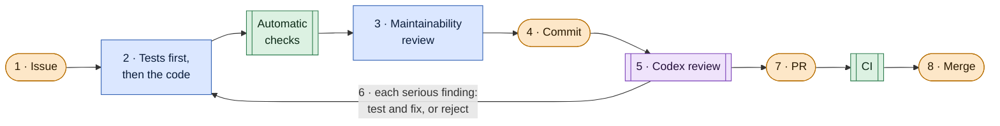

# agent-workflow-template

[](https://github.com/fab-codes/agent-workflow-template/actions/workflows/ci.yml)

A Deno template for building software with AI coding agents without losing control of the code.

- **Claude Code writes** the code and its tests.
- **Automatic checks** (types, lint, formatting, tests) run on every change before it is committed.
- **A second AI reviews** every pull request: Codex, a model from a different vendor, not Claude grading its own
  work.
- **A person decides** what gets committed, pushed and merged.

## Why

A model that reviews its own code tends to miss the mistakes it made writing it, and a rule that lives only in a
prompt can be forgotten.

This template takes both out of the model's hands. The checks run on their own, the reviewer is a different
model, and the rules that matter most are enforced rather than only written: a push asks for confirmation
whatever the model decides, and CI flags a PR whose recorded review is not of its latest commit.
[`docs/workflow.md`](docs/workflow.md) lists what is enforced and what is only written.

## The cycle



Orange: the user decides · Blue: Claude Code · Green: automatic · Purple: Codex

The full cycle, step by step, is in [`docs/workflow.md`](docs/workflow.md). For a small change that is already
settled, `/quick` runs it up to the PR with every check, and stops only when a check finds a problem or something
needs an answer from you.

## Built with itself

From its first pull request on, every change to this repository went through a PR with Codex's review recorded
in it. The cycle grew the same way, one PR at a time: issues became the unit of work with
[#3](https://github.com/fab-codes/agent-workflow-template/issues/3), tests first with
[#14](https://github.com/fab-codes/agent-workflow-template/issues/14), the quick lane with
[#33](https://github.com/fab-codes/agent-workflow-template/issues/33). The
[closed pull requests](https://github.com/fab-codes/agent-workflow-template/pulls?q=is%3Apr+is%3Aclosed) are the
full log. Two to start from:

- [#13](https://github.com/fab-codes/agent-workflow-template/pull/13): Codex flagged missing tests for new
  permission rules. Part of the finding was accepted, with tests that reproduce it and the fix; the rest was
  rejected, with the reason written in the PR. The next commit passed review with no findings.
- [#35](https://github.com/fab-codes/agent-workflow-template/pull/35): a small fix that went through `/quick`,
  from issue to PR, with no question beyond the confirmation prompts.

## Requirements

Deno 2.9.6, Claude Code, Codex CLI and `gh`, installed and authenticated.

## New project

1. Create the repository from the template, with **Use this template** on GitHub or with `gh`. A `git clone` would
   carry along the template's history and remote; this way you start from a clean commit:

   ```bash
   gh repo create <name> --private --template <owner>/agent-workflow-template --clone
   ```

2. Allow only merge commits, as in the template: a repository created from a template gets its files and
   branches, not its settings.

   ```bash
   gh repo edit <owner>/<name> --enable-merge-commit --enable-squash-merge=false --enable-rebase-merge=false
   ```

3. Create `main` from `develop` and publish it. The new repository holds only the template's default branch,
   `develop`, which stays the default: step 5 reviews against `origin/develop`, PRs target it, and `Closes #<n>`
   closes an issue only in PRs to the default branch.

   ```bash
   git push origin develop:main
   ```

4. Fill in the placeholders, starting from `AGENTS.md` §1. Each one says what to write; when the search finds
   only this README, the template is adapted.

   ```bash
   git grep -n "TODO(template)"
   ```

5. Replace this README with the project's own.
6. Run `deno task verify`: it must pass before the first PR.
7. Optional: a ruleset on `develop` that requires the checks `verify` and `reviewed-sha`, the jobs of `ci.yml`
   and `reviewed-sha.yml`. Without it a red check is visible, but it does not block the merge. Rulesets are
   available in public repositories on every plan, GitHub Free included, and in private ones with GitHub Pro,
   GitHub Team and GitHub Enterprise Cloud. Once both checks have passed on a first PR:

   - **Settings** → **Rulesets** → **New ruleset** → **New branch ruleset**, enforcement status **Active**;
   - under "Target branches", **Add a target** with the pattern `develop`;
   - **Require status checks before merging**: add `verify` and `reviewed-sha`, each with the **+** button;
   - **Create**.

## What it contains

The empty sections of `AGENTS.md` and `CLAUDE.md` are deliberate: they are the placeholders of step 4, which a new
project fills in.

| File                                                                  | Status                                                                          |
| --------------------------------------------------------------------- | ------------------------------------------------------------------------------- |
| `AGENTS.md`, `CLAUDE.md`                                              | Generic rules plus placeholders to fill in                                      |
| `scripts/check-invariants.ts`                                         | Generic invariants; the project's own are added here                            |
| `.claude/settings.json`, `.claude/hooks/verify.ts`                    | Ready: permissions, attribution, Stop hook                                      |
| `.claude/skills/grill-me/SKILL.md`, `.claude/skills/grill-me/LICENSE` | Ready: `/grill-me`, the interview that settles the plan, its terms and its ADRs |
| `.claude/skills/diagnose/SKILL.md`, `.claude/skills/diagnose/LICENSE` | Ready: `/diagnose`, the confirmed cause of a bug, before `/issue`               |
| `.claude/skills/issue/SKILL.md`, `.claude/skills/issue/LICENSE`       | Ready: `/issue`, the agreed change as one issue, or one per slice               |
| `.claude/skills/tdd/SKILL.md`, `.claude/skills/tdd/LICENSE`           | Ready: `/tdd`, each test seen red before its code                               |
| `.claude/skills/review/SKILL.md`                                      | Ready: `/review`, maintainability and fit with the issue                        |
| `.claude/skills/codex-review/SKILL.md`                                | Ready: `/codex-review`, the Codex review and its record                         |
| `.claude/skills/pr/SKILL.md`                                          | Ready: `/pr`, push and PR with the Review section                               |
| `.claude/skills/quick/SKILL.md`                                       | Ready: `/quick`, the quick lane: a small, settled change from issue to PR       |
| `.github/ISSUE_TEMPLATE/change.md`                                    | Ready: the sections of an issue                                                 |
| `.github/workflows/ci.yml`, `.github/pull_request_template.md`        | Ready: CI and the PR's Review section                                           |
| `.github/workflows/reviewed-sha.yml`, `scripts/check-reviewed-sha.ts` | Ready: the CI check of the Reviewed SHA                                         |
| `deno.json`, `.gitattributes`, `.gitignore`, `tests/`                 | Ready; `deno.json` grows with the project's dependencies                        |
| `docs/workflow.md`                                                    | Ready: the cycle on one page                                                    |

## If the project does not use Deno

The template assumes Deno, which the Stop hook and the invariants script need anyway. With another stack, these
change:

- the command run by `.claude/hooks/verify.ts`;
- the `Verify` step of `.github/workflows/ci.yml`;
- §2, §3, §6 and §9 of `AGENTS.md`;
- the check on the test command in `scripts/check-invariants.ts`, which reads it from `deno.json`.

## Publishing the template

Once, after creating the repository on GitHub, mark it as a template, with `develop` as its default branch and
merge commits as the only merge method: a project created from the template starts from that branch, GitHub
reads `Closes #<n>` only in PRs to the default branch, and squash and rebase merging rewrite the commits of a PR,
so `main` would diverge from `develop` (`AGENTS.md` §12).

```bash
gh repo edit <owner>/agent-workflow-template --template --default-branch develop --enable-merge-commit --enable-squash-merge=false --enable-rebase-merge=false
```
