# Development workflow

How a change goes from request to merge. This is an overview: the complete, binding rules are in
[`AGENTS.md`](../AGENTS.md) §12 and in [`CLAUDE.md`](../CLAUDE.md), and where they differ, those prevail.

## The cycle

```mermaid
flowchart TD
    S1(["1 · The user asks for a change<br/>or names an open issue"]):::user
    OPEN{"Issue already open?"}:::claude
    P{"Non-trivial?<br/>more than 3 files, structure, config"}:::claude
    PL["Claude lays out the plan"]:::claude
    GM(["The user runs /grill-me"]):::user
    GR["Claude asks, round by round,<br/>until every decision is settled"]:::claude
    OK1(["The user approves the plan"]):::user
    IS(["The user runs /issue"]):::user
    IW["Claude writes the issue on GitHub,<br/>or one per slice after the go-ahead on the split"]:::claude
    S2["2 · Claude creates the branch of an unblocked issue,<br/>writes code and tests"]:::claude
    HK[["Stop hook at end of turn<br/>deno task verify"]]:::automatic
    S3["3 · Claude runs /review<br/>report only, no changes"]:::claude
    S4(["4 · The user approves the commit"]):::user
    CM["Claude commits"]:::claude
    S5[["5 · codex review against origin/develop<br/>read-only sandbox"]]:::codex
    F{"P0/P1 findings?"}:::codex
    S6["6 · Claude writes the test that reproduces it and the fix,<br/>or explains the rejection"]:::claude
    DEC(["The user decides"]):::user
    CH{"Did the code change?"}:::claude
    S7(["7 · The user approves push and PR"]):::user
    PR["Claude pushes and opens the PR to develop<br/>that closes the issue, with the Review section"]:::claude
    CI[["GitHub CI: verify and reviewed-sha"]]:::automatic
    S8(["8 · The user merges<br/>GitHub closes the issue"]):::user

    S1 --> OPEN
    OPEN -->|yes| S2
    OPEN -->|no| P
    P -->|yes| PL --> OK1 --> IS
    P -->|yes, decisions open| GM --> GR --> OK1
    P -->|no| IS
    IS --> IW --> S2
    S2 --> HK
    HK -->|red, fix it| S2
    HK -->|green| S3 --> S4 --> CM --> S5 --> F
    F -->|yes| S6 --> DEC --> CH
    CH -->|yes, new commit| CM
    CH -->|no| S7
    F -->|no| S7
    S7 --> PR --> CI
    CI -->|red| S2
    CI -->|green and findings closed| S8

    classDef user fill:#fde7c8,stroke:#b76e00,color:#2b1a00
    classDef claude fill:#dbe7ff,stroke:#2f5fb3,color:#0b1d3a
    classDef automatic fill:#dcf1e2,stroke:#2e7d4f,color:#0d2a17
    classDef codex fill:#efe3fb,stroke:#7a3fb8,color:#24103a
```



Orange: user · Blue: Claude Code · Green: automatic (hook, CI) · Purple: Codex

## The steps

The gate is what it takes to move on. **Enforced** means Claude Code or CI guarantees it; **written**, that it is
a rule Claude follows.

| #   | Who           | What happens                                                                                                                                                                                                                                                                                                                                                                                                                                                                                                            | Gate                                                                                                                        |
| --- | ------------- | ----------------------------------------------------------------------------------------------------------------------------------------------------------------------------------------------------------------------------------------------------------------------------------------------------------------------------------------------------------------------------------------------------------------------------------------------------------------------------------------------------------------------- | --------------------------------------------------------------------------------------------------------------------------- |
| 1   | User, Claude  | The request, or an issue already open. If it touches more than three files, the structure or the configuration, Claude lays out the plan and waits; with decisions still open, the user can run `/grill-me` instead, which settles them one round of questions at a time. Then `/issue`: Claude writes what was agreed as a GitHub issue, from `.github/ISSUE_TEMPLATE/change.md`; a change that does not fit one PR becomes one issue per slice, each with its Blocked by, after the user's go-ahead on the breakdown. | User's go-ahead on the plan and on any split (written); the user runs `/issue` (written) and confirmation prompt (enforced) |
| 2   | Claude        | The branch `feat/<n>-…` or `fix/<n>-…` of the issue, from `origin/develop`, with the user's go-ahead, once every issue in its Blocked by is closed as completed: one closed as not planned is for the user to judge. Then code and tests. At the end of the turn the Stop hook runs `deno task verify`, if relevant files changed. If it is red the turn does not end and Claude fixes it; on the second failure it stops and alerts the user.                                                                          | `verify` green (enforced)                                                                                                   |
| 3   | Claude        | `/review`: over-engineering, consistency with neighboring files, comments, fit with the issue. It produces a report and does not touch the files.                                                                                                                                                                                                                                                                                                                                                                       | None: the report is shown to the user                                                                                       |
| 4   | User, Claude  | Commit in English, Conventional Commits, with the why in the body.                                                                                                                                                                                                                                                                                                                                                                                                                                                      | User's go-ahead on the commit (written); no AI attribution (enforced)                                                       |
| 5   | Claude, Codex | `/codex-review`: `git fetch origin`, then the fixed command below. Codex works read-only and reports only P0 and P1. The output is shown in full and saved with SHA, model and effort in `.git/codex-review/`.                                                                                                                                                                                                                                                                                                          | None: the outcome holds only for the reviewed SHA                                                                           |
| 6   | Claude, user  | For each P0/P1, `/codex-review` proposes the test that reproduces it and the fix, or a reasoned rejection, and records the outcome. If the code changes, new commit and back to 5.                                                                                                                                                                                                                                                                                                                                      | The user decides (written)                                                                                                  |
| 7   | User, Claude  | `/pr`: push and PR to `develop`, with `Closes #<n>` and the Review section filled in from the template and the records of `/codex-review`. CI runs `verify` and `reviewed-sha`.                                                                                                                                                                                                                                                                                                                                         | The user runs `/pr` (written) and confirmation prompt (enforced)                                                            |
| 8   | User          | Merge. GitHub closes the issue, because `develop` is the default branch.                                                                                                                                                                                                                                                                                                                                                                                                                                                | `verify` and `reviewed-sha` green, every finding closed (written: without a ruleset GitHub does not block it)               |

The step 5 command, the same on every PC:

```
codex review -c project_doc_max_bytes=65536 -c model_reasoning_effort=xhigh --base origin/develop
```

Always this one, with no additional instructions: whoever wrote the code does not choose what the reviewer looks
at.

- `project_doc_max_bytes=65536` makes Codex read `AGENTS.md` in full. The default of 32,768 bytes would truncate
  a longer file without warning; an invariant makes `verify` fail if the file exceeds the limit.
- `model_reasoning_effort=xhigh` pins the effort: without local configuration it would be the model's default,
  even `low`. The model stays the CLI's default and is recorded in the PR.
- `--base origin/develop` because the local `develop` falls behind after merges on GitHub.

The command is also written in `AGENTS.md` §12, and that is the copy the invariant reads and `/codex-review`
runs: if you change it, change it in both files.

## Three checks that do not overlap

| Level                    | Who runs it                                            | What it looks at                                                  | When          |
| ------------------------ | ------------------------------------------------------ | ----------------------------------------------------------------- | ------------- |
| Mechanical               | `deno task verify`: check, lint, fmt, test, invariants | Everything that can be checked without judgment                   | Step 2 and CI |
| Maintainability          | Claude, with `/review`                                 | Over-engineering, consistency, comments, fit with the issue       | Step 3        |
| Correctness and security | Codex, a different model                               | Only P0 and P1, each with a concrete scenario (Code Review Rules) | Step 5        |

Each one leaves out what the others cover: two judgments on the same checklist would look like two independent
checks without being so. For the same reason Claude Code's `/code-review` and `/security-review` do not replace
step 5: they can be added, never used in place of Codex.

## Enforced or only written

**Enforced by Claude Code or CI**, whatever the model does:

- confirmation prompt for `git push`, `gh pr create/edit/merge/close/comment/review`, the `gh issue` writes,
  `git reset/clean/restore` and deleting branches and stashes (`.claude/settings.json`);
- `.env` neither readable nor editable, except `.env.example`;
- no AI attribution in commits and PRs (`attribution` in `.claude/settings.json`);
- `deno task verify` at the end of the turn (Stop hook) and on every PR (CI);
- the Reviewed SHA of the PR body, which must be the head of the PR, on every PR to `develop` and every edit of
  its body (CI, `reviewed-sha`): a red check is visible, but without a ruleset it does not block the merge;
- the invariants in `scripts/check-invariants.ts`: tests without network, `AGENTS.md` within the limit Codex
  reads, no `export default`, no barrel files or `utils.ts`, the direction of the layers, and the project's own.

**Only written**, that is, rules Claude follows:

- confirmation for commit, merge, rebase, branch creation;
- confirmation for dependencies, `deno.json`, `Dockerfile`, writes to real data and file deletions;
- git commands in the normal form, without `-C`, so that the confirmation prompts recognize them;
- PR merge only with CI green and findings closed.

## Who reads what

| File                                       | Read by                                           | Contains                                                                            |
| ------------------------------------------ | ------------------------------------------------- | ----------------------------------------------------------------------------------- |
| `AGENTS.md`                                | Claude Code (imported by `CLAUDE.md`), Codex      | The project standards and the Code Review Rules                                     |
| `CLAUDE.md`                                | Claude Code                                       | Build order, workflow, real data, portability                                       |
| `.claude/settings.json`                    | Claude Code (harness)                             | Permissions, attribution, Stop hook                                                 |
| `.claude/hooks/verify.ts`                  | Claude Code, at the end of the turn               | Runs `deno task verify` if relevant files changed                                   |
| `.claude/skills/grill-me/SKILL.md`         | Claude Code, on `/grill-me`, launched by the user | Step 1: the interview that settles the decisions of a change                        |
| `.claude/skills/issue/SKILL.md`            | Claude Code, on `/issue`, launched by the user    | Step 1: the agreed change as a GitHub issue                                         |
| `.claude/skills/review/SKILL.md`           | Claude Code, on `/review`                         | The four lenses of the review                                                       |
| `.claude/skills/codex-review/SKILL.md`     | Claude Code, on `/codex-review`                   | Steps 5 and 6: the Codex review and the record of its outcome                       |
| `.claude/skills/pr/SKILL.md`               | Claude Code, on `/pr`, launched by the user       | Step 7: push and PR, with the Review section from the records                       |
| `deno.json`, `scripts/check-invariants.ts` | `deno task verify`                                | The Definition of Done and the invariants                                           |
| `.github/workflows/ci.yml`                 | GitHub Actions                                    | `deno task verify` on every PR and on every push to `main`/`develop`                |
| `.github/workflows/reviewed-sha.yml`       | GitHub Actions                                    | `scripts/check-reviewed-sha.ts` on every PR to `develop` and every edit of its body |
| `scripts/check-reviewed-sha.ts`            | `.github/workflows/reviewed-sha.yml`              | That the Reviewed SHA of the PR body is the head of the PR                          |
| `.github/ISSUE_TEMPLATE/change.md`         | GitHub, when an issue is opened; `/issue`         | The sections of an issue                                                            |
| `.github/pull_request_template.md`         | GitHub, when the PR is opened                     | The layout of the Review section                                                    |

## Conventions

- One issue, one branch, one PR, for every change: the issue holds what was agreed.
- Branch `feat/<n>-<description>` or `fix/<n>-<description>` from `origin/develop`, where `n` is the issue number.
- PR to `develop` with the title `<n> - <title of the issue>` and `Closes #<n>` in the body. From `develop` to
  `main` through a dedicated PR. No direct push to `develop` or `main`.
- `develop` is the default branch on GitHub, because GitHub reads `Closes #<n>` only in PRs to the default branch.
- Commits in English, Conventional Commits, without attribution trailers.
- The PR's **Review** section reports the reviewed SHA, Codex's model and effort, the full output and the outcome
  of every P0/P1 finding.

## Where the configuration comes from

After a `git pull`, on any PC, everything comes from the repository: instructions, permissions, hooks,
attribution, the Codex command and the checks. The only things left to the PC are Claude's model and effort,
chosen with `/model` and `/effort`, and the installed tools with their credentials: Deno, Claude Code, Codex CLI
and `gh`. Claude's memory is local: nothing necessary lives there.
