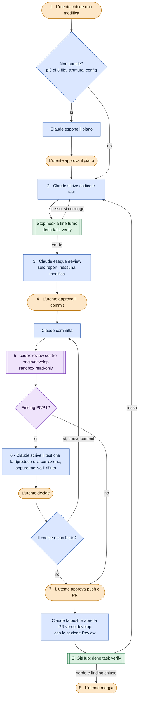

# Workflow di sviluppo

Come una modifica passa dalla richiesta al merge. È un colpo d'occhio: le regole complete e vincolanti stanno in
[`AGENTS.md`](../AGENTS.md) §12 e in [`CLAUDE.md`](../CLAUDE.md), e in caso di differenza valgono quelle.

## Il ciclo



Arancione: utente · Blu: Claude Code · Verde: automatico (hook, CI) · Viola: Codex

## I passaggi

Il gate è ciò che serve per andare avanti. **Imposto** vuol dire che lo garantisce Claude Code o la CI;
**scritto**, che è una regola che Claude rispetta.

| #   | Chi            | Cosa succede                                                                                                                                                                                                | Gate                                                                  |
| --- | -------------- | ----------------------------------------------------------------------------------------------------------------------------------------------------------------------------------------------------------- | --------------------------------------------------------------------- |
| 1   | Utente, Claude | La richiesta. Se tocca più di tre file, la struttura o la configurazione, Claude espone il piano e aspetta.                                                                                                 | Ok dell'utente al piano (scritto)                                     |
| 2   | Claude         | Codice e test. A fine turno lo Stop hook lancia `deno task verify`, se sono cambiati file rilevanti. Se è rosso il turno non si chiude e Claude corregge; al secondo fallimento si ferma e avvisa l'utente. | `verify` verde (imposto)                                              |
| 3   | Claude         | `/review`: over-engineering, coerenza con i file vicini, commenti. Produce un report e non tocca i file.                                                                                                   | Nessuno: il report si mostra all'utente                               |
| 4   | Utente, Claude | Commit in inglese, Conventional Commits, con il perché nel corpo.                                                                                                                                           | Ok dell'utente al commit (scritto); nessuna attribuzione AI (imposto) |
| 5   | Claude, Codex  | `git fetch origin`, poi il comando fisso qui sotto. Codex lavora in sola lettura e riporta solo P0 e P1. L'output si mostra integrale.                                                                      | Nessuno: l'esito vale solo per lo SHA revisionato                     |
| 6   | Claude, utente | Per ogni P0/P1: test che la riproduce e correzione, oppure rifiuto motivato. Se il codice cambia, nuovo commit e si torna al 5.                                                                            | Decide l'utente (scritto)                                             |
| 7   | Utente, Claude | Push e PR verso `develop`, con la sezione Review compilata dal template. La CI esegue `verify`.                                                                                                            | Ok dell'utente (scritto) e prompt di conferma (imposto)               |
| 8   | Utente         | Merge.                                                                                                                                                                                                      | CI verde e ogni finding chiusa (scritto: GitHub non lo blocca)        |

Il comando del passo 5, uguale su ogni PC:

```
codex review -c project_doc_max_bytes=65536 -c model_reasoning_effort=xhigh --base origin/develop
```

Sempre questo, senza istruzioni aggiuntive: chi ha scritto il codice non sceglie cosa guarda il revisore.

- `project_doc_max_bytes=65536` fa leggere a Codex `AGENTS.md` per intero. Il default di 32.768 byte
  troncherebbe un file più lungo senza avvisare; un invariante fa fallire `verify` se il file supera il limite.
- `model_reasoning_effort=xhigh` fissa l'effort: senza configurazione locale sarebbe il default del modello,
  anche `low`. Il modello resta quello predefinito del CLI e si registra nella PR.
- `--base origin/develop` perché il `develop` locale resta indietro dopo i merge su GitHub.

Il comando è scritto anche in `AGENTS.md` §12, ed è quella copia che l'invariante legge: se lo cambi, cambialo in
entrambi i file.

## Tre controlli che non si sovrappongono

| Livello                 | Chi lo esegue                                          | Cosa guarda                                                          | Quando       |
| ----------------------- | ------------------------------------------------------ | -------------------------------------------------------------------- | ------------ |
| Meccanico               | `deno task verify`: check, lint, fmt, test, invarianti | Tutto ciò che si verifica senza giudizio                             | Passo 2 e CI |
| Manutenibilità          | Claude, con `/review`                                  | Over-engineering, coerenza, commenti                                 | Passo 3      |
| Correttezza e sicurezza | Codex, un altro modello                                | Solo P0 e P1, ciascuno con uno scenario concreto (Code Review Rules) | Passo 5      |

Ognuno lascia fuori ciò che coprono gli altri: due giudizi sulla stessa checklist sembrerebbero due controlli
indipendenti senza esserlo. Per lo stesso motivo `/code-review` e `/security-review` di Claude Code non
sostituiscono il passo 5: si possono aggiungere, mai usare al posto di Codex.

## Imposto o solo scritto

**Imposto da Claude Code o dalla CI**, qualunque cosa faccia il modello:

- prompt di conferma per `git push`, `gh pr create/merge/close/comment/review`, `git reset/clean/restore` e la
  cancellazione di branch e stash (`.claude/settings.json`);
- `.env` illeggibile e non modificabile, tranne `.env.example`;
- nessuna attribuzione AI in commit e PR (`attribution` in `.claude/settings.json`);
- `deno task verify` a fine turno (Stop hook) e su ogni PR (CI);
- gli invarianti di `scripts/check-invariants.ts`: test senza rete, `AGENTS.md` entro il limite che Codex legge,
  nessun `export default`, nessun barrel file né `utils.ts`, la direzione dei layer, e quelli propri del progetto.

**Solo scritto**, cioè regole che Claude rispetta:

- conferma per commit, merge, rebase, creazione di branch;
- conferma per dipendenze, `deno.json`, `Dockerfile`, scritture su dati reali e cancellazioni di file;
- comandi git nella forma normale, senza `-C`, così i prompt di conferma li riconoscono;
- merge della PR solo con CI verde e finding chiuse.

## Chi legge cosa

| File                                       | Letto da                                      | Contiene                                                       |
| ------------------------------------------ | --------------------------------------------- | -------------------------------------------------------------- |
| `AGENTS.md`                                | Claude Code (importato da `CLAUDE.md`), Codex | Gli standard del progetto e le Code Review Rules               |
| `CLAUDE.md`                                | Claude Code                                   | Ordine di costruzione, workflow, dati reali, portabilità       |
| `.claude/settings.json`                    | Claude Code (harness)                         | Permessi, attribuzione, Stop hook                              |
| `.claude/hooks/verify.ts`                  | Claude Code, a fine turno                     | Lancia `deno task verify` se sono cambiati file rilevanti      |
| `.claude/commands/review.md`               | Claude Code, su `/review`                     | Le tre lenti della review di manutenibilità                    |
| `deno.json`, `scripts/check-invariants.ts` | `deno task verify`                            | La Definition of Done e gli invarianti                         |
| `.github/workflows/ci.yml`                 | GitHub Actions                                | `deno task verify` su ogni PR e su ogni push a `main`/`develop` |
| `.github/pull_request_template.md`         | GitHub, all'apertura della PR                 | Lo schema della sezione Review                                 |

## Convenzioni

- Branch `feat/<n>-<descrizione>` o `fix/<n>-<descrizione>`, dove `n` è il numero della PR.
- PR verso `develop` con titolo `<n> - <descrizione in inglese>`. Da `develop` a `main` si passa con una PR
  dedicata. Nessun push diretto su `develop` o `main`.
- Commit in inglese, Conventional Commits, senza trailer di attribuzione.
- La sezione **Review** della PR riporta lo SHA revisionato, modello ed effort di Codex, l'output integrale e
  l'esito di ogni finding P0/P1.

## Da dove viene la configurazione

Dopo un `git pull`, su qualunque PC, tutto arriva dal repository: istruzioni, permessi, hook, attribuzione,
comando di Codex e controlli. Restano al PC solo modello ed effort di Claude, scelti con `/model` e `/effort`, e
gli strumenti installati con le loro credenziali: Deno, Claude Code, Codex CLI e `gh`. La memoria di Claude è
locale: niente di necessario vive lì.
